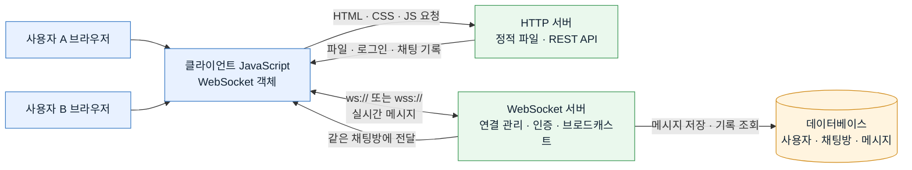
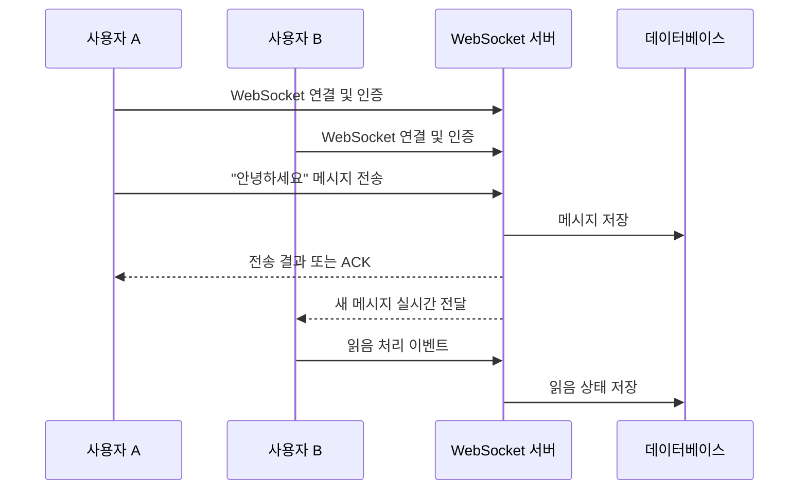

# WebSocket

## WebSocket이란?

WebSocket은 클라이언트와 서버 사이에 지속적인 양방향 통신 연결을 만들어 주는 프로토콜이다. 일반적인 HTTP 요청처럼 클라이언트가 요청할 때만 서버가 응답하는 방식이 아니라, 연결이 유지되는 동안 클라이언트와 서버가 언제든지 데이터를 주고받을 수 있다.

WebSocket 연결은 처음에 HTTP 요청으로 시작한다. 서버가 연결 업그레이드를 승인하면 이후 통신은 WebSocket 방식으로 전환되며, 매번 새로운 HTTP 요청을 만들지 않고 작은 메시지를 실시간으로 주고받을 수 있다.

주요 특징은 다음과 같다.

- 연결을 한 번 맺으면 여러 메시지를 계속 주고받을 수 있다.
- 서버가 클라이언트의 요청을 기다리지 않고 먼저 메시지를 보낼 수 있다.
- 실시간 알림, 채팅, 게임, 주식 시세와 같은 기능에 적합하다.
- 연결이 끊어질 수 있으므로 재연결, 오류 처리, 인증을 고려해야 한다.

## HTTP와 WebSocket의 차이

| 구분 | HTTP | WebSocket |
|---|---|---|
| 통신 방식 | 요청-응답 방식 | 양방향 실시간 통신 |
| 연결 | 요청마다 처리하거나 keep-alive로 관리 | 연결을 맺은 뒤 지속적으로 유지 |
| 메시지 시작 주체 | 일반적으로 클라이언트 | 클라이언트와 서버 모두 가능 |
| 서버의 즉시 전달 | 클라이언트의 요청이 있어야 응답 가능 | 서버가 원하는 시점에 전송 가능 |
| 오버헤드 | 요청마다 HTTP 헤더가 포함될 수 있음 | 연결 후에는 상대적으로 작은 메시지 단위로 전송 |
| 적합한 기능 | 페이지 조회, CRUD API, 파일 요청 | 채팅, 실시간 알림, 온라인 게임 |
| 통신 종료 | 응답 후 종료되거나 keep-alive 유지 | 명시적으로 닫거나 오류가 날 때까지 유지 |
| 주소 형식 | `http://`, `https://` | `ws://`, `wss://` |

HTTP와 WebSocket은 서로 대체 관계라기보다 용도가 다르다. 예를 들어 채팅 서비스에서 로그인, 채팅방 목록 조회, 과거 메시지 조회는 HTTP API로 처리하고, 새 메시지의 실시간 전달은 WebSocket으로 처리할 수 있다.

## 실시간 채팅 서비스의 전체 구조

```text
┌─────────────┐       HTTP        ┌──────────────┐
│  브라우저    │ ────────────────> │ HTTP 서버     │
│             │ <──────────────── │ REST API     │
└──────┬──────┘  로그인/목록/기록  └──────┬───────┘
       │                                  │
       │ WebSocket 연결                   │
       │ ws:// 또는 wss://                │
       ▼                                  ▼
┌────────────────────────────────────────────────┐
│              WebSocket 서버                    │
│ 연결 관리 · 메시지 수신 · 채팅방 브로드캐스트 │
└──────────────────────┬─────────────────────────┘
                       │
                       ▼
                 ┌──────────┐
                 │ 데이터베이스 │
                 │ 메시지 저장 │
                 └──────────┘
```

위 구조를 Mermaid로 표현하면 다음과 같다. Mermaid를 지원하는 Markdown 뷰어에서는 아래 그림으로 표시된다.



핵심 흐름은 다음과 같다.



### 동작 흐름

1. 브라우저가 HTTP 서버에서 HTML, CSS, JavaScript 파일을 받는다.
2. 사용자가 로그인하면 HTTP API로 인증하고 세션 또는 토큰을 발급받는다.
3. 클라이언트가 WebSocket 서버에 연결하면서 인증 정보와 참여할 채팅방을 전달한다.
4. WebSocket 서버는 연결된 클라이언트와 채팅방 정보를 관리한다.
5. 사용자가 메시지를 보내면 서버가 메시지를 검증하고 데이터베이스에 저장한다.
6. 서버가 같은 채팅방에 연결된 다른 사용자들에게 새 메시지를 전달한다.
7. 각 브라우저는 받은 메시지를 화면에 즉시 추가한다.

## 메시지 예시

클라이언트와 서버는 JSON 형식으로 메시지를 주고받는 경우가 많다.

```json
{
  "type": "chat",
  "roomId": "room-1",
  "senderId": "user-1",
  "content": "안녕하세요!",
  "sentAt": "2026-09-15T10:00:00Z"
}
```

`type`을 사용하면 일반 메시지뿐 아니라 입장, 퇴장, typing 상태, 읽음 처리 같은 이벤트도 구분할 수 있다.

## 구현할 때 고려할 점

- 연결 시 사용자를 인증하고, 사용자가 해당 채팅방에 참여할 권한이 있는지 확인한다.
- 메시지를 서버에서 검증한 후 저장하고 다른 사용자에게 전달한다.
- 브라우저 새로고침이나 네트워크 문제에 대비해 재연결 로직을 둔다.
- 연결 종료 시 해당 사용자를 채팅방 목록에서 제거한다.
- 운영 환경에서는 암호화된 `wss://`를 사용한다.
- 여러 대의 서버를 운영한다면 Redis Pub/Sub 같은 메시지 브로커를 사용해 서버 간 메시지를 동기화한다.

현재 프로젝트의 `server.js`는 정적 파일을 제공하는 HTTP 서버이다. 실제 채팅 기능을 구현하려면 이 HTTP 서버와 함께 WebSocket 서버를 추가하고, `client.js`에서 `WebSocket` 객체로 연결하면 된다.
